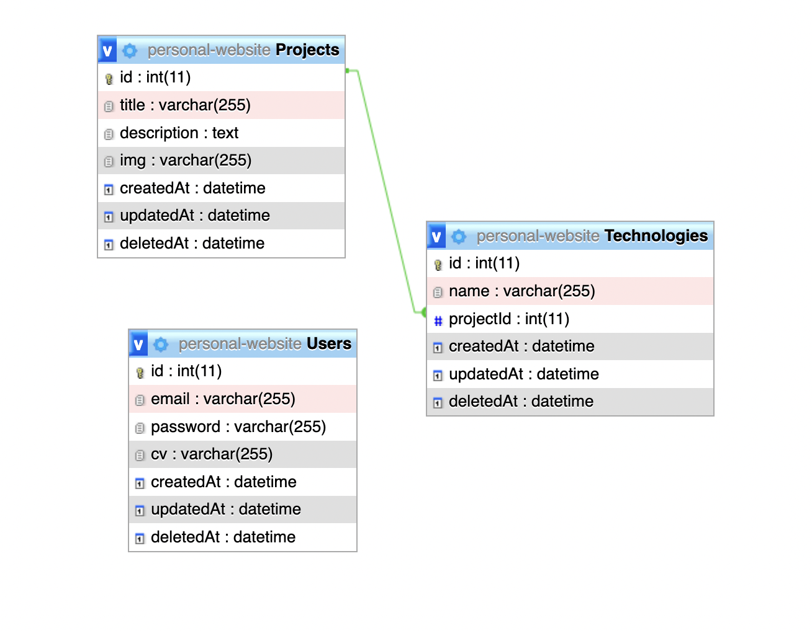

# Personal Website API

This is the RESTful API of the my personal website that's written in the Nest js.

## Installation 

- Make sure you had clone this repo
- Copy environment from `.env.example` to `.env`
- Configure your `.env` file according to your MySQL credentials
- Open your terminal in this project and run 

	```bash
	npm install
	```

## How To Run This RESTful API

- Create The Personal Website Database

	```bash
	CREATE DATABASE personal-website CHARACTER SET utf8 COLLATE utf8_general_ci;
	```

- Run On Development

	```bash
	npm run start:dev
	```

- Run On Production

	```bash
	npm run build
	npm run start:prod
	```

The API reads its port from the `PORT` environment variable and always listens
on `0.0.0.0`. When `PORT` is unset (or invalid), it falls back to `9000`.

## API Documentation

Interactive Swagger UI at [`/api-docs`](http://localhost:9000/api-docs) — the OpenAPI JSON lives at `/api-docs-json`. With the default `PORT` (9000), that's http://localhost:9000/api-docs.

Protected routes expect the JWT in an `x-access-token` header — in Swagger UI, click **Authorize** and paste the token from the login response.

## Run With Docker Compose

This starts MySQL 8 and the API together:

```bash
cp .env.example .env   # fill in DB_*, JWT and email settings
docker compose up --build
```

- The database runs as the `db` service; `DB_HOST` is set to `db` and `DB_PORT`
  to `3306` automatically, so those two values in `.env` are ignored in Docker.
- MySQL data is stored in the `db_data` volume, so it survives restarts.
- The API listens on `0.0.0.0:${PORT:-9000}` inside its container and is
  published on host port `${PORT:-9000}`. With the defaults, open
  http://localhost:9000.
- To stop everything but keep the database data: `docker compose down`.

### Database-only Compose stack

If you develop the API outside Docker (`npm run start:dev`) and only want the
database in Docker:

```bash
docker compose -f docker-compose.db.yml up -d
```

- MySQL is published on host port `${DB_PORT:-3306}` — set `DB_HOST=127.0.0.1`
  (and `DB_PORT` if not 3306) in `.env` for the locally-running API.
- It shares the same `db_data` volume as the full stack, so data is common to
  both. Don't run the two stacks at the same time (same container name).

## Entity Relationship Diagram (ERD)

[](screenshoot/ERD.png)

## API SPECS

- POST `/api/v1/auth/register` Route for register new user

	Request Body

	```
	{
		"email": "your email",
		"password": "your password",
		"repeatPassword": "your repeat password"
	}
	```

- POST `/api/v1/auth/login` Route for login

	Request Body

	```
	{
		"email": "your email",
		"password": "your password"
	}
	```
- POST `/api/v1/auth/access-token` Route for generate the access token

	Request Body

	```
	{
		"refreshToken": "your refresh token"
	}
	```
- POST `/api/v1/user/password` Route for sending forgot password link to an email

	Request Body

	```
	{
		"email": "your email"
	}
	```

- PATCH `/api/v1/user/password/:id` Route for reset the password

	Request Body

	```
	{
		"password": "your new password",
		"repeatPassword": "repeat your new password"
	}
	```

- GET `/api/v1/project/:id` Route to get a detail of project

- GET `/api/v1/projects` Route to get all projects

	Request Query

	```
	{
		"page": "the page in number",
		"limit": the limit in number"
	}
	```

- POST `/api/v1/project` Create a Project

	Request Body (Multipart/Form-Data)

	```
	{
		"title": "project title",
		"description": "project description",
		"technologies": "technologies",
		"img": "blog image"
	}
	```

- PATCH `/api/v1/project/:id` Generate a Text

	Request Body (Multipart/Form-Data)

	```
	{
		"title": "project title",
		"description": "project description",
		"technologies": "technologies",
		"img": "blog image"
	}
	```

- DELETE `/api/v1/project/:id` Route for deleting a project

## License
[MIT](https://choosealicense.com/licenses/mit/)